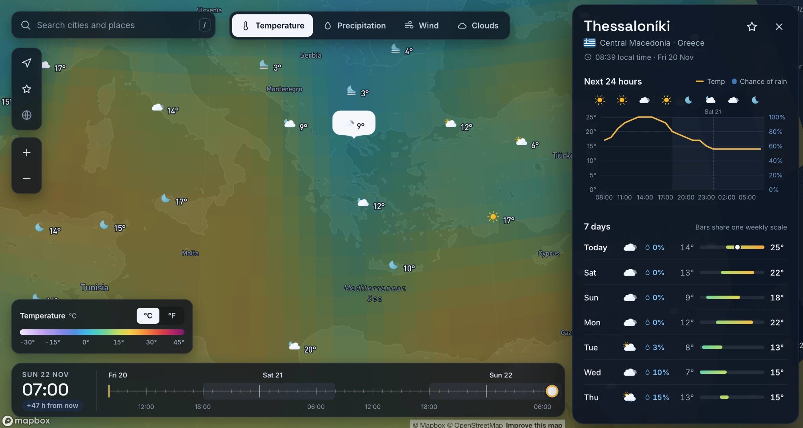
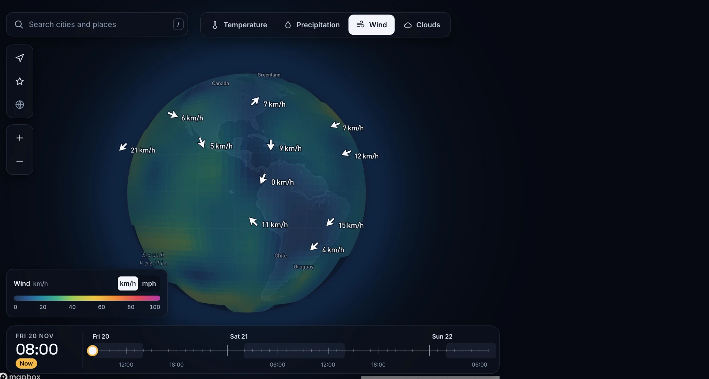
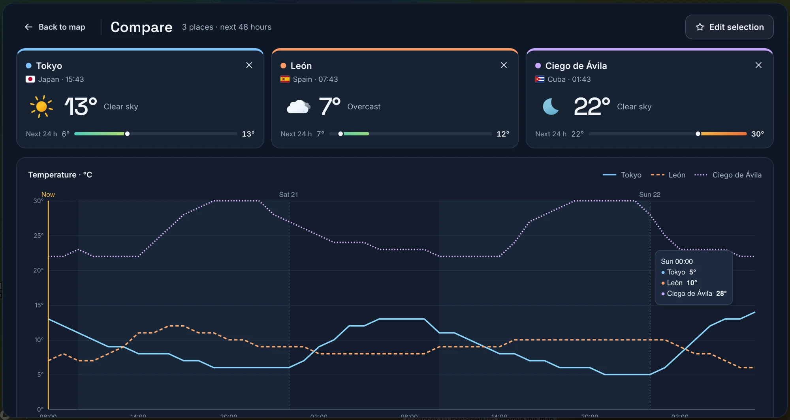

# Weather Explorer

Explore the weather anywhere in the world on an interactive globe: a TV weather map where you choose where to look.

**Live demo:** [weather-exploration-app.vercel.app](https://weather-exploration-app.vercel.app/) (for example, [Thessaloniki, 37 hours ahead](https://weather-exploration-app.vercel.app/?v=39.926,22.48,6.72&place=city:734077&t=37))

Pan the globe to see temperature, precipitation, wind or clouds across a whole region, scrub through the next 48 hours, click anywhere (sea included) or search for a place to dive into its forecast, save the places you care about, compare them side by side, and see the weather where you are.



| Wind layer at whole-globe zoom | Comparing three places over 48 hours |
| --- | --- |
|  |  |

## Contents

- [Installation and setup](#installation-and-setup)
- [Implementation choices](#implementation-choices)
- [Incomplete requirements](#incomplete-requirements)
- [Next steps](#next-steps)
- [Additional notes](#additional-notes)

## Installation and setup

Requires **Node 22.18 or newer** (the city build script runs TypeScript directly with Node's built-in type stripping) and npm.

```bash
npm install
cp .env.example .env
```

The map needs a free **Mapbox access token**:

1. Create an account at [mapbox.com](https://account.mapbox.com/auth/signup/).
2. Copy your default public token (it starts with `pk.`) from the [access tokens page](https://account.mapbox.com/access-tokens/).
3. Paste it into `.env`: `VITE_MAPBOX_TOKEN=pk.…`

Weather data comes from Open-Meteo and needs no key. Without a token the app shows a setup page instead of the map.

```bash
npm run dev            # start the dev server
npm run test           # unit tests (Vitest)
npm run build          # production build into dist/
npm run preview        # serve the production build
```

| Script | What it does |
| --- | --- |
| `npm run dev` | Dev server with hot reload |
| `npm run build` | Production build into `dist/` |
| `npm run preview` | Serve the production build locally |
| `npm run lint` / `lint:fix` | ESLint, code style included (no Prettier) |
| `npm run type-check` | Strict TypeScript check with `vue-tsc` |
| `npm run test` | Unit tests |
| `npm run build:cities` | Rebuild `public/cities.json` from GeoNames (optional, the file is committed) |

`build:cities` downloads GeoNames `cities15000.zip` and `admin1CodesASCII.txt`, keeps the 5,000 most populous cities (city sections and historical places excluded) and writes compact rows `[id, name, countryCode, admin1, lat, lon, population]` with coordinates rounded to 2 decimals. It uses Node built-ins only. Behind an HTTPS proxy, run it with `NODE_USE_ENV_PROXY=1`.

**Deploying:** the repo includes `vercel.json` (every path rewrites to `index.html`, hashed assets are cached for a year). Set `VITE_MAPBOX_TOKEN` in the Vercel project settings.

## Implementation choices

### Stack

| Choice | Why |
| --- | --- |
| **Vue 3.5 + TypeScript (strict, `noUncheckedIndexedAccess`)** | Composition API with `<script setup>`; strict indexing catches the off-by-one and missing-data cases a weather series is full of. |
| **Vite** | Fast dev server and build; `import.meta.glob` loads the icon sets. |
| **Mapbox GL JS v3** | Globe projection, WebGL symbol layers with built-in label collision, and expressions to colour features from data without re-rendering in Vue. |
| **Pinia (setup stores)** | Small, typed stores for map view, places and settings. |
| **vue-router** | A single route; it only carries shareable state in the query string. |
| **VueUse** | Debounce, media queries, page visibility, localStorage and event helpers. |
| **vue-i18n** | Every UI string, aria-label included, comes from `src/locales/en.json` (English only, British date order and 24-hour times as in the design). |
| **Tailwind CSS v4** | The design's tokens live in one `@theme` block; components use semantic utilities, never raw colours. |
| **ECharts + vue-echarts** | The two charts; only the parts used are imported from `echarts/core`. |
| **Meteocons** | Weather icons: static on the map, animated in panels (static with reduced motion). |
| **flag-icons** | SVG flags; emoji flags don't render on Windows. Each flag file is fetched only when shown. |
| **Fontsource** | Inter and Space Grotesk self-hosted, no third-party font requests. |
| **Vitest** | 341 unit tests on the logic: domain, API layer, cache, weather service, stores, URL state, search, sheet gestures. |
| **ESLint (flat config) + @stylistic** | Linting and formatting in one tool. |

There is **no backend**: the app calls Open-Meteo straight from the browser. Open-Meteo's free-tier limits apply per IP address, so each visitor brings their own budget; a proxy would put every visitor on one IP and one budget.

### Architecture

```
components  ─▶  composables / Pinia stores  ─▶  api/ (services)  ─▶  Open-Meteo
                          ▲
                       domain/   pure functions: no Vue, no Mapbox, no fetch
```

- **`src/api/`**: typed Open-Meteo clients, mappers from raw responses to domain types, the cache and the weather service. Raw API shapes never leave this folder, and nothing else touches the network.
- **`src/domain/`**: pure, unit-tested logic: WMO codes, unit conversion, colour ramps, geometry (thinning, grid snapping, nearest city), map features, URL state, forecast shaping, sun position, status decisions.
- **`src/composables/` and `src/stores/`**: glue between the service, the map and the UI (`useViewportWeather`, `useGridWeather`, `usePlaceForecast`, `usePlaceSearch`, …).
- **`src/components/`**: `map/` (map view and layers, controls), `place/` (details panel), `places/` (My places, compare), `ui/`.
- **`src/config.ts`**: every tunable (TTLs, debounce, caps, grid density, feature flags).

The Mapbox map instance lives in a `shallowRef`, never in reactive state. Changing the layer, the time or the units only rebuilds GeoJSON from cached data; it never reaches the service.

### Request strategy

The free tier allows 600 calls a minute, 5,000 an hour and 10,000 a day per IP. Open-Meteo doesn't document how multi-location requests are counted, so the app assumes **one call per location** and keeps locations low.

| Rule | How |
| --- | --- |
| Batching | Cities in view, grid points and the saved collection each go out as **one** request with many coordinates (chunked at 100). |
| Fetch only misses | Requested keys are split into cache hits and misses; only misses are requested. Panning back to a seen area costs nothing. |
| Cache keys | Dataset cities by id (`city:264371`); free points and grid points by coordinates rounded to 2 decimals (`pt:40.64,22.94`); details as `detail:<key>`; searches as `search:<query>`. |
| Cache | Memory + localStorage with per-entry TTL (overview 30 min, details 60 min, search for the session), LRU cap of 300 entries, quota-safe writes. Reloading within the TTL makes zero requests. |
| In-flight dedupe | A key that is already being fetched is awaited, never requested twice. |
| Debounce and throttle | The camera reports only after it has settled for 400 ms; overview requests start at least 1.5 s apart. |
| Limits per view | At most 48 cities (most populous per cell of an 8 × 6 screen grid) and 80 grid points. |
| Minimal payload | Only the 7 hourly variables needed, `forecast_hours=48` for the overview; one details request per place (current, 7 days hourly, daily). |
| Zero-request interactions | Layer switch, time slider, units toggle, naming a clicked point (from the bundled city dataset, no reverse geocoding), compare, My places rows. |
| Resilience | HTTP 429 is retried after 1 s, 2 s and 4 s; after that the app shows the cached data it has, says how old it is, and retries 30 s later (or on "Retry now"). |
| Hidden tab | Expired data isn't refreshed while the tab is hidden; it refreshes when you come back and at each new hour. |
| Time alignment | `timeformat=unixtime`, and values are looked up by instant, so every location shows the same moment even when cached at different times. |

A request counter (HTTP requests and locations requested this session) is always visible in development and in production with `?debug=1`.

Example: a fresh view of Europe costs two requests (about 30–48 cities and up to 80 grid points). Switching layers, scrubbing the 48 hours, opening Compare or panning back costs nothing.

### Data and attribution

Open-Meteo and GeoNames are also credited in the map's attribution control, next to Mapbox.

- Weather data: [Open-Meteo](https://open-meteo.com/), licensed under [CC BY 4.0](https://creativecommons.org/licenses/by/4.0/)
- City data: [GeoNames](https://www.geonames.org/), licensed under [CC BY 4.0](https://creativecommons.org/licenses/by/4.0/)
- Map: © [Mapbox](https://www.mapbox.com/about/maps/) © [OpenStreetMap](https://www.openstreetmap.org/copyright) contributors
- Weather icons: [Meteocons](https://github.com/basmilius/weather-icons) by Bas Milius, MIT (licence in `src/assets/weather-icons/LICENSE`)
- Flags: [flag-icons](https://github.com/lipis/flag-icons), MIT
- Fonts: Inter and Space Grotesk, SIL Open Font License 1.1

## Incomplete requirements

- **Light theme:** dropped on purpose in the design; the app is dark only.
- **Custom basemap style:** the design calls for a Mapbox Studio style with Inter uploaded. A Studio style only loads with its owner's token, which would break running the app with your own token, so the app recolours Mapbox's dark style at runtime instead. Map labels therefore use Mapbox's hosted DIN Pro rather than Inter.
- **Colour grid density:** the grid is fetched at 80 points per view and drawn smooth by interpolating between them, so it looks fine-grained but shows no detail finer than the point spacing. At whole-globe zoom only the 80 cells nearest the centre are coloured.
- **"Today" low/high in My places and Compare:** these come from the 48-hour overview data already loaded, so they cover the next 24 hours rather than the calendar day.
- **Shared links to search results:** places that aren't in the bundled city dataset are restored from a link by their coordinates and named after the nearest dataset city, not the searched name.
- **Tests:** unit tests cover the logic; there is no component or end-to-end test suite yet.

## Next steps

- A smoother field: render the grid as an interpolated raster or contour layer instead of sub-cells, and use the city values as extra samples
- A coarser grid step at whole-globe zoom so the full hemisphere is coloured with the same 80 points
- Reverse geocoding for clicked points, within the request budget
- An exploration journal (places visited, with a weather snapshot)
- A play animation for the 48-hour slider
- More languages (Greek first); all strings already go through vue-i18n
- Component and end-to-end tests (Vitest browser mode or Playwright), including request-count assertions
- A shared server cache in front of Open-Meteo for production scale (with a commercial plan), so popular cells are fetched once for everyone
- Offline support: a service worker for the app shell and the last forecasts

## Additional notes

**URL state.** The view (`v=lat,lon,zoom`), selected place (`place=city:<id>` or `pt:<lat>,<lon>`), layer (`layer=`) and time (`t=` hours from now) are kept in the URL, so a link reopens the same view. The view, layer, units and saved places are also remembered in localStorage; a URL wins over what's stored.

**Known limitations**

- On a globe, Mapbox's map bounds are approximate at low zoom. The app derives bounds from the canvas corners and filters points to the visible hemisphere before projecting them.
- The request strategy assumes multi-location requests count once per location; if Open-Meteo counts them as one call, the real usage is far lower.
- Open-Meteo returns hourly series starting at the current hour, so right after the hour changes the last slider step can be empty until the hourly refresh.
- Local times come from Open-Meteo's `utc_offset_seconds` for the forecast period.
- Pull-to-refresh is off on phones: the page never scrolls, and vertical drags that nothing under the finger can scroll are cancelled, because iOS Safari doesn't reliably honour `overscroll-behavior` for pull-to-refresh. Panels still scroll normally.

**Accessibility**

- Everything works by keyboard: `/` focuses search (an ARIA combobox: ↑ ↓ Enter Esc), the layer switcher uses arrow keys, and the time slider is a native range input with `aria-valuetext` (arrows 1 h, Shift 6 h, Page Up/Down 1 day, Home now, End last hour).
- The details drawer isn't modal: focus moves to its title on open, and Esc or × returns focus to what opened it. My places rows reorder with ↑ ↓ on the handle; moves and removals are announced.
- On mobile the sheets follow the finger (swipe up to expand, down to collapse or close), and every swipe has a button alternative: the grabber toggles the height and × closes.
- Status messages use `role="status"` or `role="alert"`; loading regions set `aria-busy`; the retry countdown is shown but not announced every second.
- Colour is never the only signal: compare lines also differ by dash, layers have icons and labels, and rain chance shows a number.
- With `prefers-reduced-motion`, panel icons are static, the location pulse and skeleton shimmer stop, panels appear without sliding, charts don't animate and the camera jumps instead of flying.
- Focus is shown with a 2 px ring on `:focus-visible` only.
